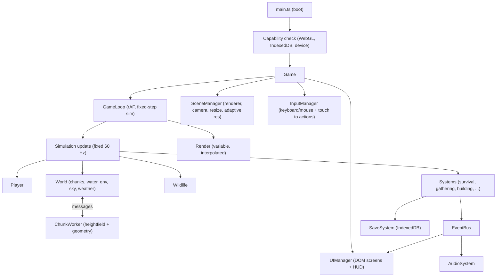
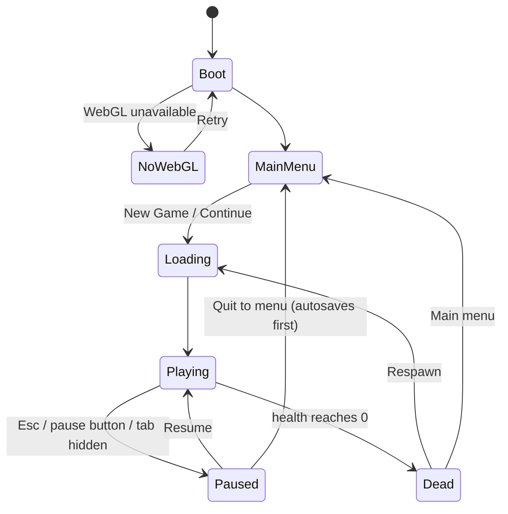

# WILD FRONTIER — Architecture

Status: Phase 2 (project foundation). Only the Phase 2 modules (core runtime, boot, diagnostics) are implemented; everything else is still a plan. PRD.md is the source of truth; this document explains **how** each PRD requirement will be met. If this document and PRD.md conflict, PRD.md wins.

---

## 1. Repository inspection (Phase 1 findings)

### 1.1 Current contents

```
WILD-FRONTIER/              <- workspace root (contains only the folder below)
└── WILD-FRONTIER/          <- project root (all work happens here)
    ├── PRD.md              (459 lines, v1.0)
    ├── src/.gitkeep        (empty)
    └── public/.gitkeep     (empty)
```

- No `package.json`, no `node_modules`, no lockfile, no source code, no assets.
- Not a git repository.
- Nothing exists yet that could break, so no code needs preserving. `PRD.md` and the `.gitkeep` files stay as they are.

### 1.2 Build environment

| Item | Value | Notes |
|---|---|---|
| Device | Infinix X6886, Android 16, aarch64, 8 cores | Also the main test device |
| Shell | Termux | `process.platform === "android"` |
| Node | v26.12.1 | Meets Vite's engine requirement (`>=22.12`) |
| npm | 12.2.1 | Registry reachable |
| RAM | 7.7 GB total, **about 1.9 GB available, swap almost full** | Builds may be slow; see risk R3 |
| Disk | 95 GB free | OK |
| git | 2.56.0 | Available (repo not initialised) |
| Browsers / headless | **None** (no Chromium, Firefox, Playwright) | See risk R1 |
| python3, pnpm, yarn | Not installed | Not needed |

### 1.3 Dependency survey (`npm view`, run 2026-10-30; nothing installed)

| Package | Latest | Android-arm64 native support | Decision |
|---|---|---|---|
| `vite` | 8.3.5 (latest), **7.3.7 chosen** | 7.x uses Rollup (`@rollup/rollup-android-arm64`) + esbuild (`@esbuild/android-arm64`) | **Use `vite@7.3.7`, pinned.** User decision (Phase 2): Vite 8 is not attempted. |
| `three` | 0.187.0 | Pure JS | **Use, pinned** |
| `@types/three` | 0.187.0 | Types only | **Use, pinned to match three** |
| `typescript` | 7.0.2 | **No android-arm64 binary** (native Go port: linux/darwin/win/bsd only) | **Use `typescript@6.0.3`** (last JavaScript-based release; works anywhere Node runs; full `strict`) |
| `esbuild` | 0.28.2 | `@esbuild/android-arm64` exists | Not a direct dependency; listed only as an optional Vite peer |

Final dependency list (Phase 2): runtime `three`; dev `vite`, `typescript`, `@types/three`. **Nothing else.** No UI framework, physics engine, state library, or test framework. Node's built-in `node --test` runs the pure-logic tests, and Node 26 strips TypeScript types natively.

Exact versions are pinned in `package.json`, without `^`. They are confirmed by an actual install and build in Phase 2 (results in §1.4).

**Decision log**
- 2026-10-31 (user): use `vite@7.3.7` directly; do not try Vite 8. This replaces the earlier "Vite 8 with Vite 7 fallback" plan.

### 1.4 Actual installed versions and native bindings (Phase 2 verified)

| Package | Installed version | Native / runtime notes on Termux (`android-arm64`) |
|---|---|---|
| `three` | `0.187.0` | Pure JS; bundled into a dedicated `three` chunk (~530 kB / ~131 kB gzip) |
| `@types/three` | `0.187.0` | Type definitions matching `three@0.187.0` (`PCFSoftShadowMap` deprecated in r186; using `PCFShadowMap`) |
| `typescript` | `6.0.3` | Pure JS compiler invoked via `node node_modules/typescript/bin/tsc` (avoids `/usr/bin/env` shebang issues when `termux-exec` is inactive) |
| `vite` | `7.3.7` | Invoked via `node node_modules/vite/bin/vite.js` |
| `rollup` (transitive) | `4.67.2` | Native Android binding `@rollup/rollup-android-arm64` installed and working |
| `esbuild` (transitive) | `0.28.2` | Native Android binary `@esbuild/android-arm64` installed and working |

---

## 2. Technical risks and environment limitations

| # | Risk / limitation | Impact | Mitigation / alternative |
|---|---|---|---|
| R1 | **No browser automation in Termux.** Playwright and Puppeteer do not support Android, and Chromium is not packaged. | I cannot render, screenshot, or click through the game myself. PRD Phase 8 manual tests (movement, camera, touch, visuals) **cannot be run by the agent**. | (a) `tsc --noEmit` and `vite build` as automated gates. (b) Unit tests for pure logic with `node --test`: noise determinism, heightfield, inventory, crafting, save validation, stats, placement validation, AI FSM transitions. (c) Built-in **diagnostics overlay** (FPS, frame ms, draw calls, triangles, chunk count, AI tick cost, pixel ratio). (d) Built-in **error overlay** that captures `window.onerror` / `unhandledrejection`, because Android Chrome has no visible console without a PC. (e) A written **manual test checklist** (TASKS.md, Phase 8) that the user runs in Chrome on this phone at `http://localhost:5173`. Features are marked "verified" only after a test confirms them. Anything not tested is reported as "untested". |
| R2 | **No iOS device or desktop browser here.** | PRD lists iOS Safari and desktop browsers. | Use only standard APIs (Pointer Events, WebGL 1/2 via three, Web Audio, IndexedDB). Handle iOS-specific issues: `touch-action`, `100dvh`, safe-area insets, AudioContext unlock on gesture, no Fullscreen API on iPhone. Desktop and iOS stay **"untested"** in the README until someone verifies them. |
| R3 | **Low free RAM / swap almost full.** | `npm install` or `vite build` may be slow or OOM-killed. | Minimal dependencies. Run builds alone (dev server stopped). If needed, use `NODE_OPTIONS=--max-old-space-size=1024`. |
| R4 | **TypeScript 7 has no Android binary.** | `tsc` from TS 7 would not install or run. | Use TS 6.0.3, which keeps strict typing. Code also respects `erasableSyntaxOnly` (no `enum`, no parameter properties, no namespaces), so Node can run it directly for tests and a future switch to TS 7 is painless. |
| R5 | **No external art or audio assets, and no licensed packs.** | PRD requires a visible character, animals, trees, and sounds, and forbids missing or broken references. | All geometry is **procedural** (PRD §5 allows this): character and animals are hierarchical primitive rigs, trees and rocks are generated meshes. Textures are generated at runtime (small canvas/DataTextures). **All audio is synthesised** with Web Audio (PRD §15 allows this). The result: zero asset files, so no broken references are possible. |
| R6 | **Texture compression (KTX2/Basis)** needs encoder tools (`toktx`/`basisu`) that are not available in Termux. Runtime-generated textures can't be pre-compressed anyway. | PRD §19 says "texture compression where supported". | Make compression mostly unnecessary: shading uses vertex colours, only a handful of small (≤256², mipmapped) procedural textures, and texture memory stays below ~16 MB. `AssetManager` will have a KTX2 loading path if real assets are added later. This deviation goes in the README's Known Limitations. |
| R7 | **Caves.** A heightfield terrain cannot have overhangs. | PRD §5 mentions small caves. | Build caves as separate **rock-shell meshes** (half-dome / grotto made of merged rock geometry) set into hillsides, with their own simple colliders and a "shelter" flag (counts as shelter for temperature). |
| R8 | **"Volumetric-inspired" fog and AAA look on mobile GPUs.** | Real volumetrics and heavy post-processing are too expensive. | Exponential fog plus height-fog terms in a custom sky/fog shader chunk. Per-time-of-day colour grading through light/fog/sky palettes and ACES tone mapping, with no full-screen post on Low/Medium. A single cheap post pass (grade + vignette) is allowed only on Ultra, and only if measurements show it fits the budget. |
| R9 | **Chunk streaming hitches** (PRD §8: no visible hitches). | Building terrain and instance buffers on the main thread causes stalls. | Heightfield sampling and chunk geometry are generated in a **Web Worker** (native Vite worker support, no package), with transferable typed arrays. The main thread only uploads results, limited to N per frame by a time budget (≈2 ms). |
| R10 | **Thermal throttling** on phones during long sessions. | FPS drops over time. | Adaptive resolution (§8.3) with hysteresis. Default mobile cap: 30 FPS mode on Low/Medium (setting: 30/60/uncapped), which gives steadier frames and less heat. |
| R11 | **Browser gestures** (pull-to-refresh, pinch-zoom, double-tap zoom, long-press menu, swipe-back). | Breaks play (PRD §7). | `touch-action: none` on the game root, `overscroll-behavior: none` on html/body, viewport `user-scalable=no`, `preventDefault` on `touchmove`/`gesturestart`, `user-select: none`, `contextmenu` blocked inside the game. Try fullscreen + `screen.orientation.lock('landscape')` on Android when the game starts; failure is silent and the game still works. |
| R12 | **Offline after load.** | PRD §1/§3: runs fully offline after load. | All assets are procedural and bundled, so after the first load no network is needed. **Phase 7 option:** a hand-written service worker for offline *reload*. Service workers need `localhost` or HTTPS. |
| R13 | **No WebGL** on some devices. | PRD §19 requires a clear fallback. | Boot-time WebGL check. If it fails, show a static, styled HTML message (no dead buttons, only "Retry", which really re-runs detection). |

---

## 3. High-level architecture

Rendering: three.js `WebGLRenderer`, one scene. UI: plain DOM + CSS overlay (no framework). Logic: plain TypeScript modules connected through a typed event bus and a single loop.



### 3.1 Game states



- Death outcome (PRD §10, **user decision 2026-10-31**): **respawn**.
  - Location: the last campfire/shelter the player placed or used (most recent one that still exists), or the world spawn camp if there is none.
  - Stats reset to safe values (not full, not critical).
  - Penalty: the player loses a **small portion of raw resources only** (wood, stone, fiber, berries): 15% of each raw resource stack, rounded down, so small stacks (1–6 items) lose nothing. It is **not** half a stack.
  - Tools, equipped items, consumables (bandage, flask), and placeables are **always kept**.
  - The death screen lists exactly what was lost. There is never a stuck state.
- Tab hidden (`visibilitychange`) pauses the simulation and suspends the AudioContext.

---

## 4. Project structure

Follows PRD §21 and adds a few support modules where they keep files small. No file should go much beyond ~400 lines.

```
index.html
package.json / tsconfig.json / vite.config.ts
public/                      (favicon, manifest; optional sw.js in Phase 7)
src/
  main.ts                    boot: capability checks, create Game
  core/
    Game.ts                  state machine, wiring, lifecycle
    GameLoop.ts              rAF loop, fixed-step accumulator, FPS cap
    SceneManager.ts          renderer, scene, camera, resize, pixel ratio
    AssetManager.ts          shared geometries/materials/textures registry + disposal
    EventBus.ts              typed pub/sub
    InputManager.ts          action map; merges KeyboardMouseInput + TouchInput
    KeyboardMouseInput.ts
    TouchInput.ts            joystick, camera swipe, buttons (multitouch via pointerId)
    DeviceProfile.ts         mobile/GPU detection, default preset
    GraphicsSettings.ts      Low/Medium/High/Ultra preset tables, apply()
    PerformanceMonitor.ts    frame stats, adaptive resolution controller
    Settings.ts              user settings model (+ persistence through SaveSystem)
    Random.ts                seeded PRNG (mulberry32 / sfc32)
    math.ts                  clamp, lerp, damp, smoothstep, angle helpers
  world/
    WorldGenerator.ts        seed, region layout, rivers, lake, landmarks, POIs
    Noise.ts                 seeded simplex 2D + fBm / ridged
    Heightfield.ts           height(x,z), normal, slope, biome weights (pure, worker-safe)
    Terrain.ts               chunk manager, LOD rings, skirt meshes, terrain material
    ChunkWorker.ts           Web Worker: builds chunk geometry + scatter lists
    Water.ts                 river ribbons, lake plane, waterfall, water shader
    Environment.ts           instanced trees/rocks/bushes/grass/props per chunk, LOD
    Landmarks.ts             cabins, camps, caves, watchtower, ruins (procedural)
    Sky.ts                   sky dome shader, sun/moon discs, stars
    DayNightCycle.ts         time of day, sun/moon direction, light/fog palettes
    Weather.ts               clear/cloudy/fog/rain states, wind, transitions
    Particles.ts             pooled rain, dust/pollen, fire embers, mist
    Collision.ts             spatial hash of static colliders (circles, AABBs)
    WorldState.ts            depleted resources, opened containers, structures
  player/
    Player.ts                aggregate: model + controller + stats + anim
    PlayerController.ts      kinematic movement, gravity, ground snap, collisions
    CameraController.ts      orbit follow, smoothing, zoom, collision avoidance
    PlayerStats.ts           health, hunger, thirst, stamina, temperature (data)
    AnimationController.ts   state machine + procedural pose blending
    CharacterModel.ts        procedural hierarchical rig
  ai/
    WildlifeManager.ts       spawning/pooling around player, tiered updates
    AnimalAI.ts              per-animal FSM (species-config driven)
    AnimalSpecies.ts         deer, rabbit, bird, wolf configs
    AnimalModels.ts          procedural rigs + gait animation
  systems/
    InventorySystem.ts
    ItemDatabase.ts          item defs (id, name, icon, stack, description, use)
    CraftingSystem.ts
    Recipes.ts
    GatheringSystem.ts
    InteractionSystem.ts     nearest interactable query + prompt
    BuildingSystem.ts
    SurvivalSystem.ts
    DiscoverySystem.ts       named locations, discovery notifications
    SaveSystem.ts            IndexedDB, schema, validation, autosave, fallback
    SaveSchema.ts            types + runtime validators + migrations
    AudioSystem.ts           Web Audio graph, buses, volume
    SoundSynth.ts            procedural sound generators
  ui/
    UIManager.ts             screen stack, focus, transitions, input capture
    MainMenu.ts
    HUD.ts                   stats, compass, prompt, toasts, quick slots
    InventoryUI.ts
    CraftingUI.ts
    MapUI.ts                 canvas 2D map from heightfield, zoom/pan, markers
    SettingsUI.ts
    PauseMenu.ts
    DialogUI.ts              confirm dialogs, save confirmation, death screen
    TouchControlsUI.ts       joystick + action buttons layout
    DiagnosticsUI.ts         FPS/draw calls overlay + error overlay
    Icons.ts                 inline SVG icon set (original)
    dom.ts                   tiny element helpers
  styles/
    main.css                 tokens + base
    hud.css / panels.css / touch.css (imported from main.css)
tests/                       node --test files for pure modules
```

---

## 5. Core runtime

### 5.1 Game loop (PRD §3: stable rAF loop)

- One `requestAnimationFrame` callback. `dt` is clamped to 100 ms, so a tab resume never fast-forwards the simulation.
- **Fixed-step simulation** at 60 Hz with an accumulator (max 4 substeps per frame). Movement and physics stay identical whatever the frame rate. The render pass interpolates the player and camera transforms.
- Optional frame cap (30 / 60 / unlimited) that skips render frames by timestamp. The 30 FPS cap is the mobile default on Low/Medium.
- Update order per step: Input, Player, Camera target, Wildlife (tiered), Survival, Systems, World streaming request. Per frame: DayNight/Weather visuals, Particles, Render, HUD (throttled).
- **No DOM writes inside the hot path except HUD**. HUD updates at 10 Hz and writes only changed values (cached last values, `transform`/`width` via CSS custom properties). Menus are DOM screens that render on open and on events, never per frame.

### 5.2 Input

- `InputManager` exposes one `InputState` each step: `move: Vec2 (-1..1)`, `look: Vec2 delta`, `zoom`, and pressed/held flags for `jump, sprint, crouch, interact, inventory, pause, map, craft, rotateBuild, confirm, cancel`.
- Desktop: WASD, Space, Shift, E, I, C, Esc (PRD §7). Added: M map, Tab/K crafting, R rotate while building, LMB confirm / RMB cancel while building. Mouse look uses Pointer Lock, which is requested on click into the canvas. Without it, look works by drag.
- Touch: Pointer Events tracked **by `pointerId`**, which gives true multitouch (move, look, and act at the same time).
  - Left zone: floating joystick (appears where the thumb lands, within the left 40% of the screen). Pushing past ~90% deflection auto-runs. The sprint button toggles sprint.
  - Right zone: camera swipe with sensitivity setting; two-finger pinch on the right zone = zoom.
  - Buttons: Jump, Sprint (toggle), Interact (contextual; only enabled when an interactable is in range), Crouch (toggle), Inventory. Also Map and Pause icons at the top. Build mode shows Rotate / Confirm / Cancel.
- Touch UI is shown on touch-primary devices (`pointer: coarse`) and switches automatically on first touch/mouse use.

### 5.3 Rendering setup

- `WebGLRenderer({ antialias: preset.msaa, powerPreference: "high-performance", stencil: false })`, ACES Filmic tone mapping, sRGB output.
- One `DirectionalLight` (sun or moon, colour-lerped), `HemisphereLight` for sky/ground ambient, and pooled `PointLight`s for campfires/torch (max 2 dynamic point lights on Low/Medium, 4 on High+; the nearest win).
- Shadows: one directional shadow map whose frustum follows the player (≈60 m box on Medium), texel-snapped to avoid shimmer. Only player, animals, nearby trees/rocks/structures cast shadows. Terrain receives. Shadow map updates every frame on High+ and every 2nd frame on Medium; off on Low (blob shadow decal under player/animals instead).
- Materials: `MeshLambertMaterial` on Low/Medium, `MeshStandardMaterial` on High/Ultra, both extended with `onBeforeCompile` for wind sway / fog tweaks. Material instances are **shared** through `AssetManager`, and shaders are pre-compiled during the loading screen (`renderer.compile`) to avoid first-use stalls.

---

## 6. World

### 6.1 Determinism (PRD §8)

`seed` (uint32) is the only input. `Noise`, `Heightfield`, `WorldGenerator`, and scatter placement all use the seeded PRNG and are pure functions of `(seed, coordinates)`. That is why the worker and the main thread produce identical results. Saves store the seed plus *deltas* (depleted resources, structures, opened containers), never geometry. A unit test asserts that the same seed gives byte-identical heights and scatter lists.

### 6.2 World layout

- Size: **2048 m × 2048 m** playable square (Low preset: same world, shorter view distance). Chunk size 64 m, giving a 32×32 chunk grid.
- Macro layout from the seed:
  - Mountain range along one edge (ridged noise, rocky/snow-capped material) that forms a natural boundary.
  - Central valley forests (dense pine), open grassland meadows, a lake basin.
  - 1–2 rivers traced downhill from the mountains to the lake as splines. The heightfield is carved along each river. A waterfall sits where a river crosses a steep step.
  - Points of interest placed with Poisson-disk spacing and suitability rules (flat ground, near water, etc.): spawn camp, abandoned cabins, campsites, caves, watchtower, ruined bridge, lookout peak. Each has a name for discovery.
- **Boundaries** (PRD §8 graceful stop): the outer 128 m rises into impassable mountains / dense deadfall. A soft invisible wall at the edge pushes back smoothly, and a HUD hint ("The wilderness is impassable beyond here") appears. No hard snap, no falling off.
- Terrain materials: blended in the shader by height, slope, and moisture weights: grass, forest floor, dirt path, sand/riverbank, rock, snow. Uses vertex-colour weights plus 1–2 small tiling procedural detail textures.

### 6.3 Chunk streaming and LOD (PRD §8, §19)

- Rings around the player:
  - LOD0 (32×32 segments)
  - LOD1 (16×16)
  - LOD2 (8×8)
  - Ring radii come from the preset (e.g. Medium: 2 / 4 / 6 chunks).
- Terrain chunk edges get skirts so LOD seams never show gaps.
- `ChunkWorker` returns positions, normals, material weights, and a scatter list (tree/rock/bush transforms) as transferable buffers. The main thread uploads at most one terrain chunk + one scatter batch per frame within a ≈2 ms budget.
- Unloaded chunk meshes go back to a **pool** of geometries (same vertex count per LOD) instead of being disposed and reallocated.
- Fog end distance is tied to the view distance, so chunks appear inside the fog and pop-in stays hidden.

### 6.4 Vegetation and props (PRD §8, §19, §20)

- `InstancedMesh` per *(chunk-group, species, LOD)*. Bounding spheres per group give real frustum culling (one huge InstancedMesh would never be culled).
- Tree LOD:
  - Near: full procedural pine (trunk + 3–5 cone layers, ≈300 tris).
  - Mid: low-poly (≈60 tris).
  - Far: crossed-quad impostor (4 tris, alpha-tested texture rendered once at load from the real tree mesh).
- Grass: instanced blades/clumps only within ~25–60 m (preset-based). Density fades with distance, and the patch follows the player in a ring buffer. Off on Low. Wind sway runs in the vertex shader (shared `uTime`, `uWind` uniforms), so it costs no CPU per instance.
- Placement follows rules, not random scatter (PRD §5): density from forest noise × slope × moisture, clustering, clear areas around POIs/paths/rivers, larger trees in the forest interior, sparse edge trees, rock clusters on slopes.
- Every gatherable instance has a stable ID `(chunkX, chunkZ, index)`. Depleting it hides that instance by setting a zero-scale matrix, records it in `WorldState`, and starts its respawn timer.

### 6.5 Water (PRD §5, §8)

- Lake: one plane with a custom shader: two scrolling procedural normal layers, Fresnel sky reflection (sky colour, not a reflection render), depth tint from terrain height under the water (heightfield texture lookup), shoreline foam band.
- Rivers: ribbon meshes along the spline with UVs that flow downstream (scrolling normals).
- Waterfall: vertical ribbon with a fast-scrolling foam shader plus pooled mist particles and a positional water sound.
- Gameplay: water depth is checked from the heightfield. Shallow water slows movement and deep water means swimming (slow, drains stamina; when stamina is empty the player takes damage). The player can **drink** at any water edge with the Interact prompt.

### 6.6 Collision (PRD §6, §8)

- Ground: analytic `Heightfield.height(x, z)` (bilinear on the same grid the mesh uses at LOD0, so visual and physical ground match). The character can never fall through terrain: the capsule bottom is clamped to ≥ ground every step.
- Static obstacles: `Collision.ts` keeps a uniform spatial hash (8 m cells) of circles (tree trunks, rocks) and oriented boxes (cabins, shelters, cave shells). Player and animals resolve with push-out in XZ. Steep slopes (>45°) block uphill movement.
- No physics engine; this is cheaper and fully deterministic.

### 6.7 Sky, day/night, weather (PRD §5, §14)

- One full day = 20 real minutes by default (configurable 10/20/40). Phases: dawn, day, golden hour, dusk, night.
- Palettes (sun colour/intensity, hemisphere sky/ground, fog colour/density, sky zenith/horizon) are **keyframed per phase** and interpolated smoothly every frame, so there are no sudden changes. Night uses cool moonlight at a low but playable intensity, plus stars in the sky shader.
- Weather: Markov state machine (Clear, Cloudy, Fog, Rain). Each state lasts 3–8 in-game hours, and transitions cross-fade over ~60 s: fog density, light dimming, rain particle count, wind strength, audio levels.
- Rain: pooled GPU particle system (one `Points` or instanced streaks around the camera) with a count capped by preset (Low 300 / Medium 800 / High 1500 / Ultra 2500).
- Weather and time feed `SurvivalSystem` through an ambient temperature function.

---

## 7. Player

- **PlayerController**: kinematic capsule (r 0.35 m, h 1.8 m). Velocity is approached with exponential damping (acceleration/deceleration) toward a target speed per state:

  | State | Speed |
  |---|---|
  | crouch | 1.5 m/s |
  | walk | 2.5 m/s |
  | run | 4.5 m/s, default when the stick/keys are fully engaged |
  | sprint | 7 m/s, costs stamina |

  Jump uses an impulse with coyote time (0.1 s) and a jump buffer (0.1 s). Gravity applies, with ground snap on slopes. A landing event fires with impact strength (drives the landing animation, camera dip, and sound).
- The player model faces the movement direction, relative to the camera yaw.
- **CameraController**: orbit around a shoulder pivot with yaw/pitch (pitch clamped -60°..+70°) and zoom distance 2.5–8 m (setting + scroll/pinch). The position is smoothed with critically damped springs.
  - **Collision**: from pivot to desired camera position, sample the heightfield along the ray (8 samples) and test the spatial-hash colliders (sphere-cast against circles/boxes). The camera distance shrinks to the nearest hit minus a margin and smoothly returns. The camera is always kept ≥ 0.3 m above the terrain.
  - Sensitivity, invert-Y, and zoom are in Settings.
- **AnimationController**: explicit FSM `Idle ⇄ Walk ⇄ Run ⇄ Sprint`, `→ Jump → Fall → Land`, `Crouch(Idle/Walk)`, `Gather(chop | mine | pick)`, `Swim`, `Drink`. Each state has a procedural pose function (joint rotations driven by phase). Transitions blend poses over 0.15–0.25 s. Gather animations fire a "hit" event at the impact frame, which is what triggers sound + resource gain (PRD §11).
- **CharacterModel**: hierarchical rig (hips, spine, head, upper/lower arms and legs, hands, feet) built from low-poly primitives with merged geometry per bone. Outdoor clothing palette; holds the equipped tool or torch in the right hand. About 1.5k tris.

---

## 8. Performance plan (PRD §19 — critical)

### 8.1 Budgets (mid-range Android, Medium preset)

| Metric | Target |
|---|---|
| Frame rate | Stable 30 FPS (mobile default cap), 60 FPS on desktop/High |
| JS update per frame | ≤ 6 ms total; AI ≤ 1.5 ms; streaming upload ≤ 2 ms |
| Draw calls | ≤ 120 (Low ≤ 70) |
| Triangles | ≤ 350k (Low ≤ 150k) |
| Texture memory | ≤ 16 MB |
| GC | No per-frame allocations in hot paths (reuse `Vector3`s, preallocated arrays) |

These are targets, not claims. Real numbers come from the diagnostics overlay on this device in Phase 7/8.

### 8.2 Graphics presets

| Setting | Low | Medium | High | Ultra |
|---|---|---|---|---|
| Pixel ratio (max) | 0.75 | 1.0 | 1.5 | min(DPR, 2) |
| Adaptive res range | 0.5–0.75 | 0.6–1.0 | 0.75–1.5 | 1.0–2.0 |
| View distance (chunks) | 4 | 6 | 8 | 10 |
| Shadows | off (blob) | 1024, every 2nd frame | 2048 | 2048 + softer (PCFSoft) |
| Grass | off | 30 m, sparse | 45 m | 60 m dense |
| Tree LOD distances | short | medium | long | longest |
| Materials | Lambert | Lambert | Standard | Standard |
| MSAA | off | off | on | on |
| Rain particles | 300 | 800 | 1500 | 2500 |
| Point lights | 1 | 2 | 4 | 4 |
| Post grade pass | off | off | off | on (if within budget) |
| Default FPS cap | 30 | 30 | 60 | uncapped |

- **DeviceProfile** defaults: touch-primary + (low `deviceMemory`, or ≤4 `hardwareConcurrency`, or known weak GPU string via `WEBGL_debug_renderer_info`) gives Low. Other mobile gives Medium. Desktop gives High. The user can override everything, and the choice persists.

### 8.3 Adaptive resolution

`PerformanceMonitor` keeps a 2 s rolling average of frame time:
- If it is above budget for 2 consecutive windows, lower the pixel ratio by one step (0.1).
- If it is under 70% of budget for 5 windows, raise it by one step.
- It always stays within the preset's range.

The hysteresis prevents oscillation, and the feature can be toggled in Settings.

### 8.4 Other techniques

- Instancing (vegetation, rocks, grass, rain, props) and geometry/material reuse.
- Frustum culling per chunk group; LOD by distance.
- Object pooling: chunk geometries, animals, particles, toasts.
- Distance-tiered AI: near (<40 m) every step, mid (40–120 m) every 4th step, far (>120 m) every 15th step or frozen/despawned.

---

## 9. Wildlife AI (PRD §9)

- `WildlifeManager` keeps a **fixed pool** (Low: 12, Medium: 20, High+: 30 animals). It spawns animals in suitable habitats in a ring outside the camera's view (40–150 m) and despawns beyond 200 m. Species mix by habitat:
  - deer: meadows/forest edge
  - rabbits: grassland/bushes
  - birds: flocks in trees, flushed into the air when the player is near
  - wolves: deep forest; more active at night
- `AnimalAI`: lightweight FSM per animal, with per-species parameters (speeds, perception radius, flee radius, aggression, activity schedule).

| State | Behaviour |
|---|---|
| Idle | Look around; ear/head motion |
| Wander | Pick a goal along a **path**: waypoint sampled toward food spots or along terrain contours, avoiding steep slopes and water |
| Graze/Forage ("search for food") | Move to a food spot (grass/berry bushes) and graze animation |
| Alert | Threat detected; face it |
| Flee | Run away from the threat vector, steering around obstacles; return to Wander after losing it |
| Stalk / Chase / Attack (wolves) | Wolf hunting states (see below) |

- **Threat detection**: player (distance × stance; crouching halves detection radius, sprinting doubles it), wolves (for deer/rabbits), campfires (wolves keep a distance from fire).
- Wolves:
  - Normally they patrol in pairs.
  - If the player is within 25 m (night) or 15 m (day), they stalk, then chase, and attack with telegraphed lunges (damage over time, with cooldowns).
  - They retreat when the player is near a lit campfire or holds a lit torch, or after taking a hit (if a weapon tool exists).
  - Damage is tuned not to be frustrating (PRD §10).
- **Steering**: seek/flee + obstacle avoidance via the spatial hash + ground height snap. No navmesh (too costly). The paths come from goal waypoints.

---

## 10. Gameplay systems

### 10.1 Survival (PRD §10)

| Stat | Range | Change | Restore |
|---|---|---|---|
| Health | 0–100 | Damage from wolves, falls, starvation/dehydration/freezing at 0 | Regenerates slowly when hunger & thirst > 50 and warm; resting in shelter speeds it up |
| Hunger | 0–100 | -1 per ~40 s (sprinting ×1.5) | Eat berries (+12), cooked meat (if added), cooked berries |
| Thirst | 0–100 | -1 per ~30 s (hot day ×1.3) | Drink at water (+25 per sip), water flask |
| Stamina | 0–100 | Sprint/jump/swim drain | Regenerates when not sprinting; faster when idle/crouched |
| Temperature | body °C 34–39 shown as cold to hot | Moves toward ambient: time of day, weather (rain −, fog −), altitude, campfire within 6 m (+), inside shelter (+, ignores rain), torch (+ small), wet (−) | Campfire, shelter, daytime sun |

- Rates are deliberately lenient (PRD: not frustrating). Warnings come before any damage. The difficulty setting (Relaxed/Normal) scales the rates.
- `SurvivalSystem` is pure logic over `PlayerStats` + an environment input struct, which makes it unit-testable.

### 10.2 Items, inventory, crafting (PRD §11, §12)

- Resources (PRD §11): `wood`, `stone`, `fiber`, `berries`, `water` (water is drunk directly at the source, or carried in a crafted `water_flask`; the flask is a "simple tool").
- Gather sources:
  - trees: chop (needs axe for full yield; by hand = sticks only, small amount)
  - rocks: stones by hand; the pickaxe gives more yield and lets you mine boulders
  - bushes: fiber, berries
  - containers in cabins/camps: one-time loot, persisted
- Recipes (PRD §12):

  | Item | Cost |
  |---|---|
  | Wooden Axe | 4 wood, 2 fiber |
  | Stone Pickaxe | 3 wood, 4 stone, 2 fiber |
  | Torch | 1 wood, 1 fiber |
  | Campfire | 5 wood, 4 stone (placeable) |
  | Basic Shelter | 20 wood, 10 fiber (placeable) |
  | Simple tools: Stone Knife | 1 wood, 2 stone (+fiber yield) |
  | Simple tools: Water Flask | 3 fiber, 2 wood |
  | Simple tools: Bandage | 4 fiber, restores health |

- Inventory: 24 slots + 4 quick slots. Stack sizes per item (resources 50, tools 1 with durability). Selecting a slot shows its description and actions (Use/Eat/Drink, Equip, Drop, Place).
- **Atomic crafting**: verify all inputs, then check output space (a free slot or a stack with room). If there is no space, reject with a clear message before anything is deducted. Otherwise deduct + add in a single transaction. If a gather overflows the inventory, the item is not consumed from the world (the source stays) and a "Inventory full" toast appears. **No item is ever lost** (PRD §12).
- Tools have durability and break with a notification. Equipped tool affects gather speed/yield.

### 10.3 Gathering (PRD §11)

`InteractionSystem` finds the nearest interactable within 2.5 m in front of the player (spatial hash, 10 Hz query) and shows the HUD prompt with key/button hint. Gathering plays the gather animation and, on its hit event: sound + particles (wood chips / stone dust / leaves), then inventory add, then toast "+3 Wood". Sources have HP (a tree takes 3 hits with an axe). Depletion rules (PRD §11, consistent per type):

| Source | Depletion |
|---|---|
| Trees | Fall/disappear, leave a stump, respawn after 2 in-game days |
| Rocks / bushes | Reduced yield, then empty; regrow after 1 day |
| Containers | Empty permanently |

### 10.4 Building (PRD §13)

- Selecting a placeable enters build mode: ghost preview in front of the player, snapped to terrain height and aligned to the slope normal (clamped). Rotate with R / rotate button / Q-E.
- Validation, re-checked every frame:
  - slope < 20°
  - not in water
  - no overlap with colliders, other structures, or POIs
  - within 6 m of the player
  - inside world bounds

  Preview is tinted green (valid) or red (invalid), with a text reason in the HUD (e.g. "Too steep").
- Confirm places it only if valid; otherwise the action is rejected with feedback. Cancel exits build mode without consuming anything. Items are consumed only on a successful placement.
- Campfire: point light + flicker + embers + crackle audio. Warmth radius 6 m. Burns 1 in-game day, refuel with wood (interact). Wolves keep away.
- Shelter: lean-to collider. Inside, there is no rain exposure, +temperature, and faster health/stamina regen. "Rest" interaction skips time to morning when stats allow. It also becomes the respawn point.
- Structures are stored in `WorldState` (type, position, rotation, fuel) and saved.

### 10.5 Discovery and map (PRD §17)

- Named locations (POIs + regions such as "Pine Hollow", "Silver Lake") have discovery radii. On first entry: notification banner + discovery sound, marked in `WorldState.discovered`.
- The map is drawn once per world into an offscreen canvas from the heightfield: hillshade, water, forest density tint, rivers. The overlay shows the player arrow, discovered POIs, the player's campfires/shelters, user markers (tap/click to add/remove, max 20), and fog-of-war over unexplored cells (64 m grid, revealed by visits, saved as a bitset).
- Zoom (wheel/pinch/buttons) and pan (drag).
- The compass HUD strip shows cardinal directions plus discovered POI markers within 300 m and user markers.

---

## 11. Save system (PRD §18)

- IndexedDB database `wild-frontier`, version 1, object stores:
  - `saves` (key: `"manual"`, `"autosave"`)
  - `settings` (key: `"user"`)
- Save record:

  ```ts
  { schemaVersion, savedAt, checksum, data: {
      seed, playTime, timeOfDay, day, weather,
      player: { position, yaw, stats, equipped, respawnPoint },
      inventory: { slots, quickSlots },
      crafted: { counts },             // progress stats
      world: { depleted[], containers[], structures[] },
      discovered: { locations[], fogBits(base64) }, markers[],
      progress: { daysSurvived, ... }
  } }
  ```

- **Validation**: hand-written runtime type guards (no schema lib) check every field, numeric ranges, finite numbers, known item IDs, and stack limits. A checksum (FNV-1a of the canonical JSON) detects truncation or corruption. `migrate(schemaVersion)` handles future versions.
  - If a save is invalid, it is not loaded. The menu shows "Save is damaged" with **Delete save** and **Start new game** options.
  - Continue uses the newest *valid* of manual/autosave.
- Autosave: every 3 minutes, on sleep/rest, on structure placement, on quit-to-menu, and on `visibilitychange: hidden` (best effort). The HUD shows a small save indicator, and manual save shows a confirmation dialog result ("Game saved" / error).
- Writes are not split: the whole record is written in one `put` transaction, so a partially written save cannot exist.
- **IndexedDB unavailable** (private mode, blocked, quota): `SaveSystem` switches to `MemoryStorage`. A persistent, non-blocking banner says "Saving unavailable in this browser — progress will be lost when you close the page". Gameplay continues; Continue is hidden (PRD §16, §18).
- Settings also persist through IndexedDB (memory fallback).

---

## 12. Audio (PRD §15)

- One `AudioContext`, created or resumed **only on the first user gesture** (the main menu "tap to start" / any button press). Before that, nothing plays.
- Buses: master → {music/ambience, sfx, ui}, each with a `GainNode` bound to the volume sliders (Master, Ambience, Effects, UI), persisted.
- All sounds are synthesised (`SoundSynth.ts`), so there are no audio files and no broken references:

  | Sound | Synthesis |
  |---|---|
  | Wind | Filtered noise, LFO-modulated by weather wind |
  | Forest ambience | Low noise bed + sparse procedural bird chirps (FM sweeps) by time of day; crickets at night |
  | Water | Band-passed noise; positional (PannerNode) near rivers, lake, waterfall |
  | Rain | Noise + droplet clicks; intensity follows weather |
  | Footsteps | Short filtered noise bursts varied by surface (grass/rock/water) |
  | Gathering | Chop thunk, stone clack, rustle |
  | Crafting | Short tonal sequence |
  | UI | Soft clicks/confirm/error |
  | Fire | Crackle; wolf howl at night (formant-swept oscillators) |

- Noise buffers are generated once and reused. Voice count is capped (max 16 simultaneous one-shots). The context suspends when paused or hidden.

---

## 13. UI architecture (PRD §16)

- DOM overlay `#ui-root` above the canvas. `UIManager` keeps a screen stack (MainMenu, Pause, Inventory, Crafting, Map, Settings, Dialog, Death).
- Opening a gameplay panel pauses player input (not world time, except Pause/Settings/Map on mobile, which pause the simulation).
- Screens are created once and updated on events (`inventory:changed`, `settings:changed`, ...), never re-rendered from scratch per frame.
- Every control is bound to a real handler. A dev-time check in Phase 8 lists every `button` without a handler or `disabled` state and must find zero.
- Visual rules: see **DESIGN-SYSTEM.md**.

---

## 14. Testing and verification strategy

| Layer | Tool | Who |
|---|---|---|
| Types | `tsc --noEmit` (strict, `noUncheckedIndexedAccess`) | Agent |
| Build | `vite build` | Agent |
| Pure logic unit tests | `node --test tests/` (Node 26 native TS stripping) covering Noise/Heightfield determinism, inventory stacking/overflow, crafting atomicity, recipe validation, save validation (good / truncated / corrupted / wrong types / future version), survival rates, placement validation, AI FSM transitions, adaptive-res controller | Agent |
| Runtime smoke | Dev server on `0.0.0.0`; error overlay + diagnostics overlay | User in Android Chrome, reports back |
| Manual feature checklist | TASKS.md Phase 8 checklist | User (agent cannot see the screen) |
| Desktop / iOS | Same checklist | User, if devices are available; otherwise reported as untested |

Reporting rule: a feature is reported as working only when a test or a user check confirms it. A successful build alone does not count (PRD §23).
